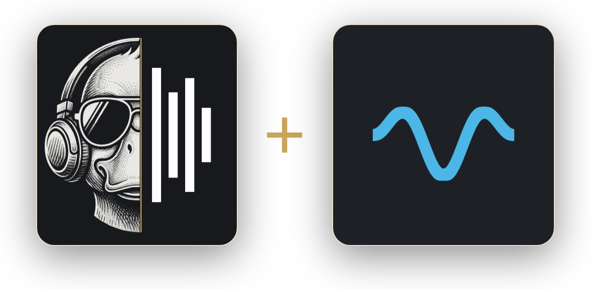

Rouen + <a href="https://github.com/statelycurmudgeon/hqpweb">hqpweb</a> (logo © statelycurmudgeon, MIT)

## Rouen + HQPWeb — v1.9.71 - Track lengths on every album screen, and the Shelf's album view in three columns

**📖 Install guide & command builder: https://meltface-80.github.io/Rouen**

## Install on Windows

Rouen runs on a Windows PC as one file: no Docker, no Node.js, nothing else to install.

1. Download **`Rouen-v1.9.71-windows-x64.exe`** (the number is the version: take the newest) from the
   [release page](https://github.com/meltface-80/Rouen/releases/latest), under *Assets*. Keep the file; do not
   delete it after running it.
2. Double-click the file. If a blue box says *"Windows protected your PC"*, click **More info**, then
   **Run anyway**. If a box asks about the network, click **Allow**.
3. A black window opens. Leave it open: that window is Rouen, and closing it stops Rouen.
4. After a few seconds Rouen opens in your web browser. If it does not, go to `localhost:3399`.
5. In Roon, go to **Settings → Extensions** and click **Enable** next to Rouen.

On a phone or tablet on the same Wi-Fi, go to the computer's IPv4 address (Settings → Network & internet →
Properties, something like `192.168.1.20`) followed by `:3399`, for example `192.168.1.20:3399`. Add `/display`
for the wall display or `/shelf` for the Shelf.

To start Rouen with Windows, right-click the file, choose **Create shortcut** (on Windows 11, **Show more
options** first), press **Windows + R**, type `shell:startup`, and drag the shortcut into the folder that opens.

Rouen updates itself by the same one tap as every other install, and your settings are kept through every
update (they live in `%LOCALAPPDATA%\Rouen\app\data`; delete `%LOCALAPPDATA%\Rouen` to remove Rouen
completely). The full guide, with Docker installs for Linux, macOS and a NAS, is on the
[install guide](https://meltface-80.github.io/Rouen/#windows).
